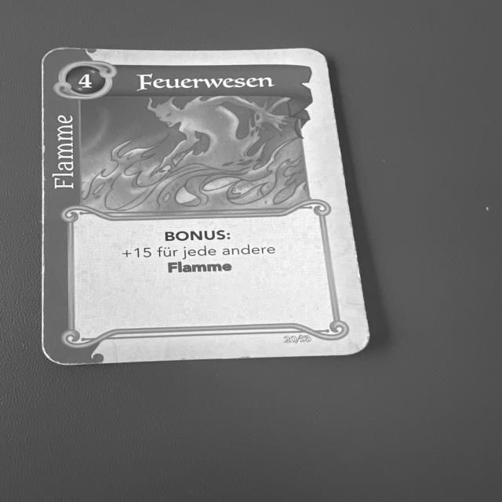
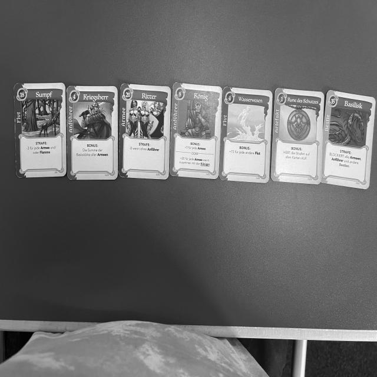
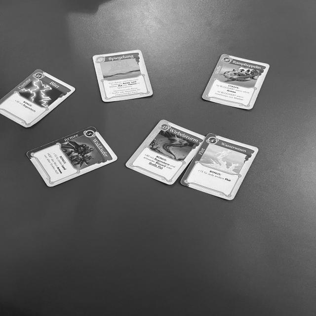

# Fantasy Realms Card Detection

Computer vision for the card game *Fantasy Realms*: YOLOv8 models that recognise each of the game's cards in
photos of a table, a discard pile or a player's hand, plus a rules engine that scores hands and recommends the
best move.

<p align="center">
  
  
  
</p>

## Results

Four YOLOv8n models, each trained for 150 epochs at 640×640 on its own scenario. Metrics are Ultralytics
validation scores at the final epoch.

| Scenario | Precision | Recall | mAP@50 | mAP@50-95 |
|---|---|---|---|---|
| Table (cards spread face-up) | 0.95 | 0.84 | **0.96** | **0.95** |
| Mixed (table + discard) | 0.81 | 0.78 | 0.87 | 0.82 |
| Discard pile | 0.81 | 0.71 | 0.81 | 0.75 |
| Hand (seven overlapping cards) | 0.42 | 0.61 | 0.57 | 0.53 |

Separated cards on a table are detected reliably. A held hand is much harder because the cards overlap and only
their top edge is visible, which is the main open problem.

## How it works

1. **Data:** ~1,600 photos of real cards (German edition) under different lighting and angles, converted from
   HEIC, sorted by card and suit, and labelled with bounding boxes in Roboflow. The labelled versions are
   published on [Roboflow Universe](https://universe.roboflow.com/houssem-ouerdiane-nmtbp/fantasy-realms).
2. **Training:** one YOLOv8n model per scenario (table, discard, hand, mixed), fine-tuned from COCO weights.
3. **Evaluation:** precision/recall/mAP curves and confusion matrices per model, plus manual checks on a set of
   fresh photos that were never used for training.
4. **Scoring assistant:** `scoring_assistant.py` implements the full card rules (base strength, bonuses,
   penalties, blanking) and, during a game, recommends which card to take from the table or deck and which one
   to discard to maximise the hand's score.

## Repository structure

```
├── fantasy_realms_detection.ipynb   # Data preparation, training, evaluation and inference
├── scoring_assistant.py             # Rules engine and move recommendations (command line)
├── data*.yaml                       # YOLO dataset configs for each scenario
├── samples/                         # Example photos
├── requirements.txt
└── .env.example                     # ROBOFLOW_API_KEY template
```

## Getting started

```bash
git clone https://github.com/houcem24/fantasy-realms-card-detection.git
cd fantasy-realms-card-detection
python -m venv .venv && source .venv/bin/activate
pip install -r requirements.txt
cp .env.example .env               # add your Roboflow API key, then load it into your environment
jupyter notebook fantasy_realms_detection.ipynb
```

The notebook downloads the dataset versions from Roboflow. Training each model takes several hours on a GPU;
the training cells are commented out and the evaluation cells read the saved `runs/` results.

To try the scoring assistant on its own:

```bash
python scoring_assistant.py
```

## Next steps

- Feed the detector's output directly into the scoring assistant instead of typing card names.
- Improve hand detection with oriented bounding boxes or segmentation, since cards overlap.

## Context

Computer vision project at the University of Passau, winter semester 2024/25.

## License

Code: [MIT](LICENSE). Dataset: CC BY 4.0 (see Roboflow). *Fantasy Realms* is a trademark of WizKids; card
artwork belongs to its respective owners.
